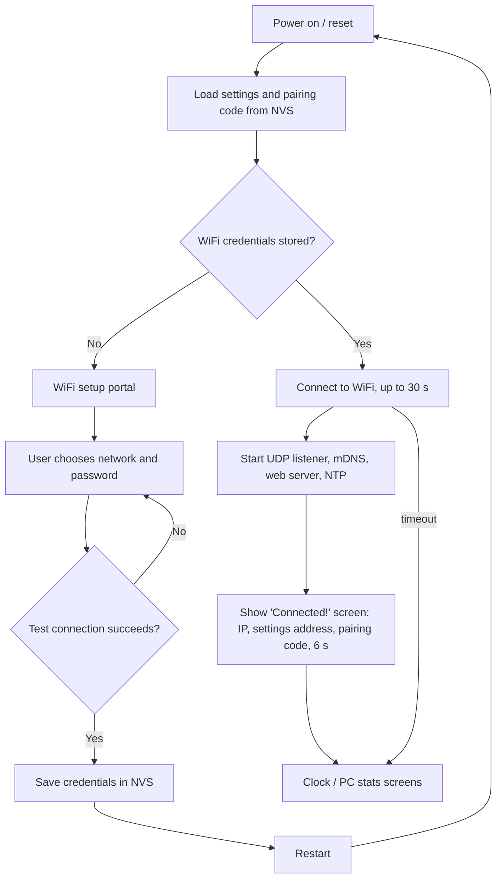

# CYD Game Clock — Functional Specification

| | |
|---|---|
| Document version | 1.0 |
| Firmware version | 1.0.0 |
| Date | 26 October 2026 |
| Hardware | ESP32-3248S035R ("CYD", 3.5" ST7796 480×320 TFT, XPT2046 resistive touch) |
| Derived from | SmallOLED-PCMonitor v1.4.2 (Keralots), ESP32-C3 + 128×64 OLED |

## 1. Purpose

The CYD Game Clock is a desk clock with animated retro-game clock faces. It also shows live statistics from a Windows 11 PC. It ports the SmallOLED-PCMonitor firmware from a small monochrome OLED to the colour touch screen of the 3.5" "Cheap Yellow Display" (CYD).

The system has two parts:

* **Firmware** on the CYD's ESP32 (PlatformIO project in the repository root).
* **Daemon**, a Python program on the Windows PC (`daemon/`). It reads the PC's sensors and sends them to the clock over the WiFi network (encrypted), or over the USB cable if WiFi is not available.

## 2. Hardware

| Function | Part / pin |
|---|---|
| MCU | ESP32-WROOM-32, 4 MB flash |
| Display | ST7796, 320×480, used in landscape (480×320). SPI: SCLK 14, MOSI 13, MISO 12, CS 15, DC 2, RST not connected |
| Backlight | GPIO 27, PWM (LEDC channel 7, 5 kHz) |
| Touch | XPT2046 on the same SPI bus: CS 33, IRQ 36 |
| Night light | On-board RGB LED, active low: R 4, G 16, B 17 (LEDC channels 4–6) |
| USB serial | CH340, 115200 baud (the PC daemon's fallback link) |

The pin assignments come from the Deskbuddy project, which runs on the same board. The touch calibration is the raw range 250–3750 (X) by 300–3880 (Y), measured in portrait and rotated in software for landscape.

## 3. Start-up behaviour



### 3.1 WiFi setup portal (no stored credentials)

1. The clock creates a WiFi access point called `CYDGameClock-XXXX`, where XXXX is the last four hex digits of its MAC address.
2. The access point uses WPA2 with a **random 8-character password, generated on every start of the portal**. The password is shown on screen with a QR code; scanning the QR code with a phone camera joins the network.
3. A DNS server answers every name with the clock's address (192.168.4.1), so phones open the setup page automatically (captive portal). The page can also be opened at `http://192.168.4.1`.
4. The page lists the nearby networks (strongest first, duplicates removed, a padlock on secured ones) with signal bars. It has a password field with a "show password" option and a **Search again** button.
5. On **Connect**, the clock tries the network while keeping the access point running. The result appears both on the page and on the clock's screen:
   * **Success:** the credentials are saved to the ESP32's non-volatile storage (NVS namespace `wifi`), the page shows the clock's new IP address, and the clock restarts after 8 seconds.
   * **Failure** (wrong password, network not found, or no answer within 20 s): an explanation is shown and the user can try again. Nothing is saved.

### 3.2 Normal start (credentials stored)

* The clock connects with the stored credentials, using a static IP if one is configured, and shows a progress bar for up to 30 s.
* If the connection fails, the clocks still run (with a "no WiFi" icon) and the clock retries every 30 s. The setup portal can be started again from the info screen or the settings website (§7, §8).
* Once connected, the clock registers the mDNS name `cydgameclock.local`, synchronises the time with NTP (`pool.ntp.org`, `time.nist.gov`), and starts the settings website (port 80) and the stats listener (UDP 4210).

## 4. Screen layout

The panel is used in landscape (480×320). Under **Display Settings → Rotate screen 180°**, the picture can be turned for mounting with the USB socket on the right.

```
┌──────────────────────────────────────────────────────────────┐
│ Sun 26/10/2026                              [◷] [▭] [i]      │  top bar, 44 px
├──────────────────────────────────────────────────────────────┤
│      ┌──────────────────────────────────────────────┐        │
│      │                                              │        │
│      │        game screen 384 × 192 px              │        │
│      │   (128 × 64 logical pixels, scaled ×3)       │        │
│      │                                              │        │
│      └──────────────────────────────────────────────┘        │
└──────────────────────────────────────────────────────────────┘
```

* **Top bar:** the date at the left, in the format chosen in the settings and preceded by the day of the week. Three 32×32 icons are right-justified with **5 px between them**:
  * **Clock face:** shows the clock. If the clock is already showing, each tap moves to the next clock style. The choice is saved.
  * **Computer:** shows the PC stats screen.
  * **Information (i):** opens or closes the information screen.
  * The icon for the current screen is highlighted.
* **Game screen:** the clock faces and the PC stats keep the original 128×64 layout of the OLED version. Each logical pixel becomes a 3×3 block, which gives the clocks a chunky retro-game look, and the content is drawn in colour. Only the parts of the picture that changed are sent to the display each frame.

## 5. Clock faces

The clock styles are the same as in SmallOLED-PCMonitor, and their animations and settings are unchanged. Because the date now sits in the top bar, the game clocks no longer draw it inside the game screen.

| Style | Description | Colours (new in this version) |
|---|---|---|
| Mario | Mario walks out at 55 s past each minute and head-butts each digit that is about to change, which then bounces. | Super Mario Bros. sky-blue background. Mario has a black cap, boots, eye and moustache, a white face and hands, and a red suit. Digits are **yellow**. |
| Standard | Large time, date and day of the week | White |
| Large | Extra-large time with the date | White |
| Space Invaders | A laser cannon (or invader) patrols the bottom and, at 55 s, shoots the digits that change; they explode into fragments. | Cannon / invader **cyan**, laser bolts **yellow**, digits and fragments **green** |
| Breakout (Arkanoid) | A ball bounces off the digits and an auto-tracking paddle; changing digits break apart and re-assemble. | Paddle **red**. Each of the 7 dot rows of the digit font is a different random colour from red, blue, green, yellow, white and cyan (neighbouring rows never match), chosen again every minute. Ball and fragments white. |
| Pac-Man | Pac-Man patrols eating pellets and eats the dots of each digit that changes. | Pac-Man **yellow**, digit and colon dots **cyan**, patrol pellets white |

* A red "no WiFi" icon appears in the top-left corner of the game screen while WiFi is down.
* The colon can be steady, blinking at a set rate, or hidden.
* Animated clocks refresh at 20 Hz, rising to 40 Hz while something is moving if "boost" is enabled. Static clocks refresh at 2 Hz. A fixed manual rate can also be set.

## 6. PC stats screen

* Shows up to 12 positions (2 columns × 5 or 6 rows) of metrics sent by the daemon, with the layout set on the settings website. It behaves as in the original: custom labels, companion metrics on the same line, progress bars with min/max/width/offset, an optional clock (`HH:MM` from the PC), and RPM "K" and network "MB/s" formats.
* Colours: text white, PC clock cyan. Bars have a grey outline and are filled **green** (below 60 %), **yellow** (60–84 %) or **red** (85 % and above) of their range.
* If the daemon reports a LibreHardwareMonitor problem (API error, not running, starting), a warning screen explains it, as in the original.
* If no stats have arrived for 10 s, the PC counts as **offline**.

### 6.1 Which screen is shown

| Situation | Screen |
|---|---|
| PC offline | Clock |
| PC comes online | PC stats (automatic, as in the original) |
| Clock icon tapped while the PC is online | Clock, until the PC goes offline and comes back |
| Computer icon tapped | PC stats. While the PC is offline this shows "Waiting for your PC", with a hint to start the daemon. |
| Info icon tapped | Info screen. Closes on a second tap, on another icon, or after 60 s. |

## 7. Information screen

This screen is drawn at full resolution and refreshed every second. It shows:

* Device name and firmware version
* **Pairing code**, in large yellow characters (needed by the daemon; see §9)
* WiFi network name and signal strength, IP address, MAC address
* Settings website address (`http://cydgameclock.local`) and how to log in
* PC stats link: "WiFi, encrypted (AES-256)", "USB serial cable" or "No PC connected", and the time since the last data arrived
* Number of rejected (unauthenticated or replayed) packets
* Uptime and free memory
* **Forget WiFi** button. **Hold it for 3 seconds**: it shows a progress fill, then deletes the stored WiFi credentials, resets the settings-website password to the pairing code, and restarts into the setup portal. A short touch does nothing.

## 8. Settings website

The site is at `http://cydgameclock.local` or `http://<IP address>`. It contains everything from the SmallOLED-PCMonitor configurator: clock style and animation tuning, time zone / DST / 12-24 h / date format, colon blink, refresh rate, brightness and scheduled night dimming, night-light brightness, static IP, metric layout and labels, export/import of the configuration as JSON, firmware update (OTA) and Reset WiFi.

Changes in this version:

* **Login required.** User name `admin`. The password is the pairing code by default, and can be changed to the user's own password (at least 8 characters) in **Security & PC Link**. **HTTP Digest** authentication is used, so the password never travels over the network in readable form. Every page, including firmware upload, needs the login.
* **Security & PC Link** section: shows the pairing code, makes a new one on request (with a warning that the daemon must then be updated), changes the website password, and shows the rejected-packet count.
* **Display Settings:** a new "Rotate screen 180°" option (the clock restarts to apply it).
* **Reset WiFi Settings** now restarts into the setup portal of §3.1.

## 9. PC stats link and security

### 9.1 WiFi (preferred)

* **Transport:** UDP to port 4210 on the clock. The clock answers each valid packet with an acknowledgement to the sender's address and port.
* **Encryption and authentication:** AES-256-GCM. Every packet is `"CGC1"` + a 12-byte random nonce + the ciphertext + a 16-byte authentication tag; `"CGC1"` is also used as associated data. A packet changed in transit, or made with a different key, fails the tag check and is dropped and counted.
* **Key:** PBKDF2-HMAC-SHA256 (10 000 iterations, salt `CYDGameClock/v1`, 32-byte output) of the **pairing code**.
  * The code has 16 characters from a 32-character alphabet without I, O, 0 and 1, which gives 80 bits. It is shown as `XXXX-XXXX-XXXX-XXXX`.
  * It is generated from the ESP32's hardware random number generator on first start and stored in NVS (namespace `security`). It is shown only on the clock's own screen and to logged-in users of the settings site.
  * It never travels over the network: the user types it into the daemon once.
* **Replay protection:** the encrypted JSON carries a random session id (`sid`), a counter (`seq`) and the PC's Unix time (`t`).
  * Within a session the counter must increase.
  * A new session must not be older than the last accepted one.
  * Once the clock has NTP time, a packet more than 120 s away from the clock's own time is rejected.
* **Acknowledgement:** the acknowledgement is encrypted the same way. It tells the daemon the IDs of the metrics the clock actually displays (`want`), so the daemon can skip reading the other sensors.

### 9.2 USB serial (fallback)

* 115200 baud, one JSON object per line, sent unencrypted: the cable itself is the trust boundary.
* **Identification:** the daemon sends `?CYDGC` and only this firmware replies `!CYDGC <MAC> <version>`. This lets the daemon find the right COM port when other CYD boards or serial devices are attached. Ports that another program already has open are skipped. Ports are opened with DTR/RTS released, so probing does not reset ESP32 boards.
* Each stats line is answered with `!ACK {…}`, which carries the same `want` list as the WiFi acknowledgement.

### 9.3 Message content

The JSON is the same as in SmallOLED-PCMonitor v2.2, with three additions: `sid`, `seq` and `t`, plus an optional `partial: true`. A partial message carries only the displayed metrics. The clock then updates those and keeps the others. A full message carries every selected metric and is sent at least every 30 s, so the settings website can list them all.

```json
{"status":1,"timestamp":"14:05","partial":true,"sid":2219,"seq":42,"t":1793023500,
 "metrics":[{"id":1,"name":"CPU","value":37,"unit":"%"}]}
```

## 10. Night light

The on-board RGB LED is used as a soft white night light, replacing the external filament LED of the OLED version. **Touch and hold anywhere on the game screen for 1 second** to switch it on or off. Its brightness is set on the settings website, and the on/off state is remembered.

## 11. Brightness

The backlight is PWM-dimmed from 0 to 255. Scheduled dimming switches to a lower level between two chosen hours, for example 22:00 to 07:00. The schedule is checked every minute.

## 12. Windows daemon

`daemon/cyd_game_clock_daemon.py` (Python 3.10 or later) is the SmallOLED-PCMonitor daemon with these changes:

| Feature | Behaviour |
|---|---|
| Sensor sources | psutil (CPU, RAM, disk), plus LibreHardwareMonitor through its REST API (`http://localhost:8085/data.json`) or WMI. Same sensor discovery as before. |
| Configuration GUI | `--edit`. Choose up to 20 sensors and custom labels; set the clock address (default `cydgameclock.local`), **pairing code**, **connection** (auto / wifi / serial), UDP port, update interval and Windows autostart. Saved in `daemon/cyd_game_clock_config.json`, which git ignores because it contains the pairing code. |
| Connection "auto" | Sends over encrypted WiFi. If the clock has not acknowledged for 12 s, it searches the COM ports for the clock (at most every 30 s) and sends over USB. When WiFi acknowledgements return, it releases the COM port. |
| Low PC load | One LibreHardwareMonitor request (or one WMI query) per update for all sensors, instead of one per sensor. Only the sensors the clock displays are read, with a full refresh every 30 s. Default interval 3 s. Nothing is printed per update in tray / `--quiet` mode. |
| Running | `python cyd_game_clock_daemon.py` (console), `--minimized` (system-tray icon), `--autostart enable` (starts at Windows sign-in, minimised, after a 10 s delay so LibreHardwareMonitor can start first). |
| Packages | `pip install -r daemon/requirements.txt` (psutil, pyserial, cryptography, wmi, pywin32, pystray, pillow) |

## 13. Stored data (ESP32 NVS)

| Namespace | Contents |
|---|---|
| `wifi` | Home network name and password |
| `security` | Pairing code; optional website password |
| `pcmonitor` | All clock, display, network and metric-layout settings (same keys as the OLED version, plus `flipScreen`) |

> **Note.** NVS is not encrypted. Someone with the device and a USB cable could read the WiFi password from flash. Fixing this would need ESP32 flash encryption, which permanently burns eFuses on the board, so it is not enabled. Keep the clock somewhere you trust, as you would any device that knows your WiFi password.

## 14. Non-functional requirements

* **Watchdog:** a 30 s task watchdog restarts the clock if the main loop hangs.
* **Robustness:** loss of WiFi or of the PC never stops the clock. WiFi reconnects automatically, and NTP is retried every 30 s until the time is known.
* **Memory:** about 63 KB of static RAM in use; the firmware uses about 55 % of the 1.9 MB app partition, which leaves room for OTA updates.
* **Daemon load:** at the default 3 s interval, one HTTP request to LibreHardwareMonitor and one small UDP packet per update.

## 15. Source layout

```
platformio.ini            build settings (TFT_eSPI pins, libraries, min_spiffs partitions)
src/main.cpp              start-up, screen selection, main loop
src/display/              canvas.*  (128x64 colour canvas, scaled push), tft.* (TFT, touch, backlight), display.* (brightness)
src/ui/                   top bar, icons, information and setup screens, touch events
src/clocks/               the clock faces (Mario, Standard/Large, Space Invaders, Breakout, Pac-Man)
src/metrics/              PC stats screen
src/network/              network.* (WiFi, UDP, serial, NTP), security.* (pairing code, AES-GCM), portal.* (WiFi setup)
src/web/                  settings website
src/config/               settings structures and NVS persistence, user_config.h (pins and constants)
daemon/                   cyd_game_clock_daemon.py, cydlink.py (WiFi/serial link), requirements.txt
Docs/                     this specification, WiFi security instructions
```

## 16. Acceptance tests

| # | Test | Expected |
|---|---|---|
| T1 | Erase the flash and power on | Setup portal screen with network name, password and QR code |
| T2 | Join the portal from a phone and enter a wrong password | "Could not connect" on the page and on screen; nothing saved |
| T3 | Enter the right password | "Connected!" with IP; restart; clock running |
| T4 | Tap the clock icon repeatedly | Cycles Mario → Standard → Large → Space Invaders → Breakout → Pac-Man; the style is kept after a restart |
| T5 | Check the colours | As in the table in §5 |
| T6 | Tap the computer icon with no daemon | "Waiting for your PC" |
| T7 | Start the daemon with the right pairing code | Stats appear within a few seconds; the info screen shows "WiFi, encrypted" |
| T8 | Daemon with a wrong pairing code | No stats; the rejected-packet count rises |
| T9 | Disconnect the PC from WiFi, with the USB cable attached | Within about 45 s, stats continue over USB; the info screen shows "USB serial cable" |
| T10 | Open the settings website | Login requested; the pairing code works as the password |
| T11 | Hold "Forget WiFi" for 3 s on the info screen | Credentials cleared; setup portal starts |
| T12 | Hold the game screen for 1 s | Night light toggles |
